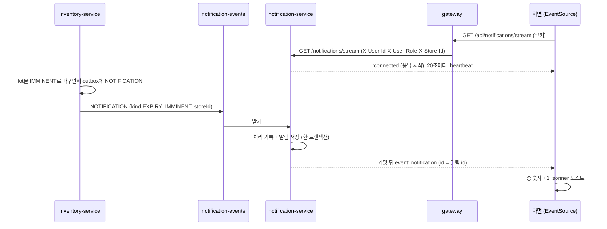

# notification-service

> FreshLink의 **화면 알림**을 만드는 서비스. 다른 서비스가 보낸 알림 쪽지(SQS)를 받아 알림을 저장하고, 로그인한 화면에 SSE로 바로 보낸다. 고객의 재입고 알림 신청도 여기서 받는다.

| 항목 | 내용 |
| --- | --- |
| 담당 | 김진아 |
| 알림 종류 (10/30 확정) | 점주: 유통기한 임박(24시간 이내), 유통기한 경과 / 고객: 재입고 알림(신청한 상품이 품절 뒤 다시 입고되면) |
| 기술 | Java 21, Spring Boot 4.0.x, Spring MVC `SseEmitter`, Spring Data JPA, Flyway, Spring Cloud AWS 4.x (SQS), MySQL |
| 관측성 | Actuator·Micrometer → Prometheus (`/actuator/prometheus`, 8080) · Micrometer Tracing → Zipkin · JSON 로그(traceId) → Alloy → Loki |
| DB | RDS `freshlink-mysql`의 `notification` 스키마 (DB 사용자 `notification_app`) |
| 큐 | `<env>-notification-events` (표준 큐, DLQ `<env>-notification-events-dlq`, 3번 실패하면 DLQ) |
| 배포 | GitHub Actions → ECR `notification-service` → ArgoCD → EKS (**파드 1개**, 아래 3장) |

알림을 이 두 가지만 하는 이유: 유통기한 알림은 이 프로젝트의 차별점이다. 새 주문·재고 부족·결제 완료·픽업 준비·픽업 기한 임박·선착순 차례 도착은 하지 않는다(선착순 상품은 입장권 받은 사람 안에서 금방 끝나 차례 알림의 실효가 없다).

---

## 1. 흐름



- 쪽지 형식은 common `NotificationMessage`(v0.6.0)이고, 명세의 진실은 [.github 화면 알림 문서](https://github.com/sesac-freshlink/.github/blob/main/docs/기능이해/화면-알림.md)다.
- 보내는 쪽은 사실(종류·점포·상품·lot·유통기한·수량)만 싣는다. 문구와 받는 사람은 여기서 정한다(`NotificationText`, `NotificationEventHandler`).
- 같은 쪽지(`messageId`)를 두 번 받아도 알림은 한 번만 생긴다(`processed_message`, common `ProcessedMessages`).

| kind | 받는 사람 | 제목 / 본문 예 | 누르면 |
| --- | --- | --- | --- |
| `EXPIRY_IMMINENT` | 그 점포 점주 (`STORE:<storeId>`) | 유통기한 임박 / 매운 컵라면 115g 4개의 유통기한이 10월 31일 23:59에 끝나요 | `/owner/expiring` |
| `EXPIRED` | 그 점포 점주 | 유통기한 경과 / 우유 2개의 유통기한이 지났어요. 폐기해 주세요 | `/owner/expiring` |
| `RESTOCKED` | 그 점포·상품에 재입고 알림을 신청한 고객 전부 (`USER:<sub>`) | 재입고 알림 / 바나나우유 상품이 다시 들어왔어요 | `/customer/stores/{storeId}/products/{productId}` |

재입고 알림은 한 번만 간다. 알림을 만들면서 그 신청을 지운다(다시 받으려면 다시 신청).

## 2. API

gateway가 `/api/notifications/**`를 `/notifications/**`로 넘긴다(로그인 필요). 서비스는 gateway 헤더 `X-User-Id`(Cognito sub)·`X-User-Role`·`X-Store-Id`만 믿는다. 고객은 자기 알림, 점주는 자기 점포 알림을 본다.

| 메서드·경로 | 설명 | 응답 |
| --- | --- | --- |
| `GET /notifications?page=0&size=20` | 내 알림 목록 (최신순, size 최대 50) | `{content:[{id, kind, title, body, link, read, createdAt}], page, size, totalElements, totalPages}` |
| `GET /notifications/unread-count` | 안 읽은 알림 수 | `{count}` |
| `PATCH /notifications/{id}/read` | 하나 읽음 (이미 읽었어도 204) | 204, 내 알림이 아니면 404 `NOTIFICATION_NOT_FOUND` |
| `PATCH /notifications/read-all` | 모두 읽음 | 204 |
| `GET /notifications/stream` | 실시간 알림 SSE (아래 3장) | `text/event-stream` |
| `GET /notifications/restock/{productId}?storeId=` | 재입고 알림을 신청했는지 (고객만) | `{storeId, productId, subscribed}` |
| `POST /notifications/restock/{productId}?storeId=` | 신청 (이미 했으면 그대로 200) | `{storeId, productId, subscribed: true}` |
| `DELETE /notifications/restock/{productId}?storeId=` | 취소 (신청이 없어도 204) | 204 |

오류는 다른 서비스와 같은 `{code, message, traceId}`다. 헤더가 없으면 401 `LOGIN_REQUIRED`, 고객이 아닌데 재입고 알림을 신청하면 403 `CUSTOMER_ONLY`, 점포·상품 번호가 없거나 0 이하면 400. PATCH·POST·DELETE는 gateway CSRF 규칙대로 `X-Requested-With: freshlink`가 있어야 한다(화면 axios가 붙인다).

## 3. SSE (`GET /notifications/stream`)

| 항목 | 값 |
| --- | --- |
| 이벤트 | `event: notification`, `id: <알림 id>`, `data: <목록의 알림 한 건과 같은 JSON>` |
| 연결 직후 | `:connected` 주석과 `retry: 3000`. 응답을 바로 시작해 CloudFront가 첫 바이트를 기다리다 끊지 않게 한다 |
| heartbeat | 20초마다 `:heartbeat` 주석(`app.stream.heartbeat-ms`). CloudFront origin 응답 타임아웃 30초·ALB 유휴 타임아웃 60초보다 짧다 |
| 다시 붙기 | 브라우저가 보내는 `Last-Event-ID`(또는 `?lastEventId=`) 뒤의 알림을 최대 50건 먼저 보낸다. 같은 알림이 두 번 갈 수 있어 화면이 id로 거른다 |
| 연결 유지 | 30분(`app.stream.timeout-ms`) 뒤 서버가 닫고 화면이 다시 붙는다 |
| 응답 헤더 | `Cache-Control: no-cache, no-transform`, `X-Accel-Buffering: no` |

**파드는 1개로 운영한다.** 연결은 그 파드 메모리에만 있어서, 파드가 여러 개면 쪽지를 받은 파드에 연결된 화면에만 알림이 간다. 늘리려면 Redis Pub/Sub 같은 방법을 먼저 붙인다. 파드가 바뀌는 배포 중에는 연결이 끊기고, 화면이 다시 붙으면서 `Last-Event-ID`로 놓친 알림을 받는다.

gateway(Gateway MVC)는 `text/event-stream` 응답을 받는 대로 흘려보내고 서비스 읽기 타임아웃이 없어서 경로별 설정이 필요 없다(gateway `application.yml` 주석, `GatewayApplicationTests`).

## 4. 데이터 모델

| 표 | 칸 | 설명 |
| --- | --- | --- |
| `notification` | `id`, `recipient`(`USER:<sub>`·`STORE:<storeId>`), `kind`, `store_id`, `product_id`, `title`, `body`, `link`, `read_at`(NULL = 안 읽음), `created_at`, `source_message_id` | 알림. `(source_message_id, recipient)` 유일 |
| `restock_subscription` | `user_id`, `store_id`, `product_id`, `created_at` | 재입고 알림 신청. `(user_id, store_id, product_id)` 유일 |
| `processed_message` | `message_id`, `processed_at` | 받은 쪽지 기록 (멱등) |

테이블은 Flyway(`src/main/resources/db/migration`)로만 바꾼다.

## 5. 폴더 구조

```
src/main/java/com/freshlink/notification/
├── common/
│   ├── config/      # Clock, @EnableScheduling, ProcessedMessages 빈
│   ├── error/       # GlobalExceptionHandler, NotificationErrorCode
│   ├── messaging/   # NotificationEventListener (@SqsListener notification-events)
│   └── web/         # AuthHeaders, Viewer (헤더 → 받는 사람 목록)
└── domain/
    ├── notification/  # 알림 저장·조회·읽음, NotificationText(문구), NotificationStream(SSE)
    └── restock/       # 재입고 알림 신청
```

## 6. dev 환경에서 실행하기

> Boot 4.0.8, Gradle 9.x, Java 21. `com.freshlink:common` 0.6.0(NOTIFICATION 쪽지, 멱등 처리)과 Spring Cloud AWS SQS를 쓴다. 쪽지는 `app.queue.notifications`(= `${QUEUE_PREFIX}notification-events`)에서 받는다. 큐가 없으면 앱이 뜨지 않는다(`queue-not-found-strategy: fail`).
>
> **DB 없이 IntelliJ에서 띄우기:** Docker Desktop을 켜고 `src/test/java/com/freshlink/notification/TestNotificationServiceApplication`을 Run 한다. AWS 큐에 붙지 않고 띄우려면 실행 설정에 `--spring.cloud.aws.sqs.listener.auto-startup=false`를 준다.

```bash
export SPRING_PROFILES_ACTIVE=dev
export DB_URL=jdbc:mysql://127.0.0.1:3306/notification   # SSM 포트 포워딩으로 연결한 dev RDS
export DB_PASSWORD=<dev Secrets Manager freshlink-dev-notification-db의 password>
export QUEUE_PREFIX=dev-<내 아이디>-                         # 개인 큐
./gradlew bootRun
```

```bash
./gradlew build    # 컴파일 + 테스트 (Docker가 있어야 MySQL 테스트가 돈다)
```

## 7. 브랜치와 기여

- `main`(배포) ← `dev`(통합, 기본 브랜치) ← `feat/<기능ID>-<설명>`
- PR이 필요하고, 합치는 조건은 CI 통과다. 쪽지 형식을 바꾸면 common과 [.github 화면 알림 문서](https://github.com/sesac-freshlink/.github/blob/main/docs/기능이해/화면-알림.md)를 같이 고치고 이태우·김경우에게 알린다.

자세한 규칙은 [.github 레포](https://github.com/sesac-freshlink/.github)를 참고한다.
